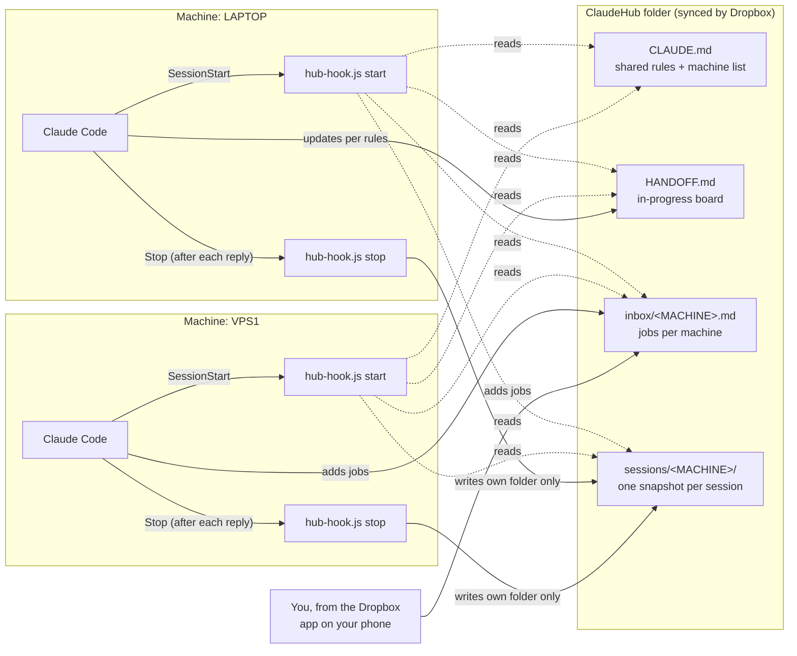

# ClaudeHub

Shared memory for Claude Code across several computers, using nothing but a
synced folder and two hooks.

If you run Claude Code on a desktop, a laptop and a couple of VPSes, each
install forgets what the others did. ClaudeHub puts one folder in Dropbox (or
any folder sync) that every install reads when a session starts and writes to
after every reply. Whichever machine you're on, Claude knows which machine it
is, what the others have been working on, and what jobs are waiting for it.

No AI calls, no network, no server. Two Node scripts, about 300 lines total.

## Architecture



**Start hook.** Prints the machine's name, `CLAUDE.md`, that machine's pending
inbox jobs, `HANDOFF.md`, and a one-line summary of the 8 most recent sessions
across all machines. Claude Code adds hook stdout to the session context, so
Claude starts every session already knowing this.

**Stop hook.** Parses the session transcript and writes
`sessions/<MACHINE>/<date>_<id>.md`: working folder, first and latest
requests, files edited, Claude's last reply and the `claude --resume` command.
It overwrites the same file on each reply, so there's one file per session.
Snapshots older than 30 days are pruned.

Each machine writes only its own `sessions/` folder, so the sync service never
has two machines editing the same file there. `HANDOFF.md` and the inboxes are
edited by Claude following the rules in `CLAUDE.md`, one section per machine.

## Install

Needs Node.js (`node -v`) and Claude Code.

1. Put this folder in the root of your Dropbox and let it sync to every machine.
2. Edit the machine table in `CLAUDE.md` to list your computers, and copy
   `HANDOFF.example.md` to `HANDOFF.md`.
3. On each machine, open a terminal in the ClaudeHub folder and run:

   ```
   node scripts/install.js LAPTOP
   ```

   using that machine's name from the table.
4. Start a new Claude Code session and ask "which machine are you on?"

The installer writes `~/.claude/claudehub.json` (machine name + hub path),
backs up `~/.claude/settings.json`, and merges in a `SessionStart` and a `Stop`
hook without touching any hooks you already have. Re-running it is safe.
To remove: `node scripts/install.js --uninstall`.

## Layout

| Path | What it is | Written by |
|---|---|---|
| `CLAUDE.md` | Shared rules and machine list | You |
| `HANDOFF.md` | What's in progress on each machine | Claude |
| `inbox/<MACHINE>.md` | Jobs for one machine | You or another machine's Claude |
| `sessions/<MACHINE>/` | Automatic session snapshots | The Stop hook |
| `scripts/` | The hook and the installer | — |

## Everyday use

- "What was I working on yesterday?" Claude checks every machine's snapshots
  and tells you which machine and folder it was in.
- Give a machine a job from anywhere: add
  `- [2026-10-20 from phone] restart the watchdog and email me the log`
  under `## Pending` in `inbox/VPS1.md`. The next session on VPS1 opens with it.
- From one machine: "put this on VPS1's list."

Pair it with Claude Code's Remote Control (`claude remote-control --name "LAPTOP"`)
and every live session shows up by name at claude.ai/code and in the Claude
phone app. ClaudeHub gives the machines shared memory; Remote Control lets you
drive them from your phone.

## Limits

- Inbox jobs are picked up when a session starts on that machine. Nothing wakes
  a machine up by itself.
- Everything in the hub syncs to every machine. Keep passwords, API keys and
  account numbers out of it.
- Session snapshots contain your prompts and Claude's replies. `.gitignore`
  excludes `sessions/`, `inbox/` and `HANDOFF.md` so you don't commit them by
  accident.

## License

MIT
